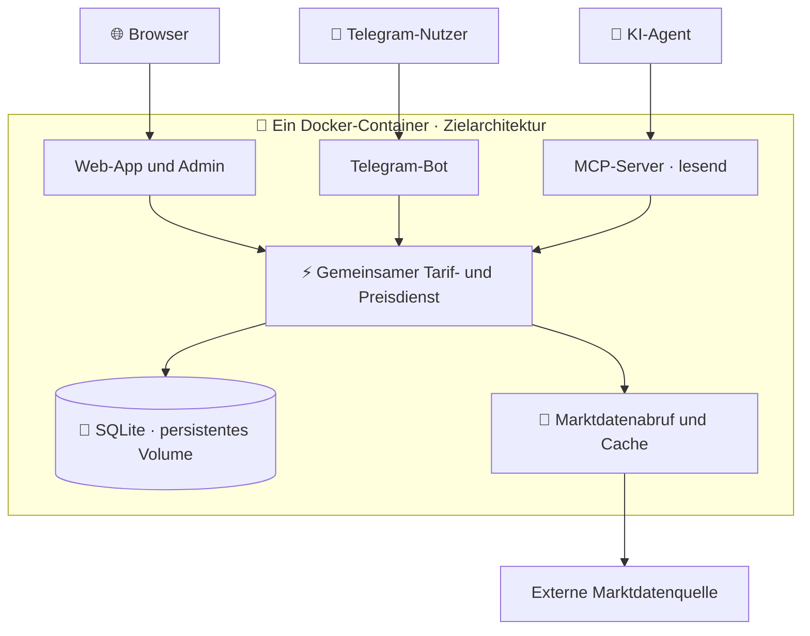

<p align="center"></p>

<h1 align="center">⚡ hAI.FlexPowerInfo</h1>
<p align="center">Dein Strompreis. Dein Tarif. Transparent aufgeschlüsselt.</p>
<p align="center">
<a href="LICENSE"></a>


</p>

> 🎯 Diese README beschreibt das Zielbild und den vorgesehenen Funktionsumfang – nicht den zugesicherten Implementierungsstand. Die Architektur-Badges sind keine Build- oder Release-Nachweise.

## 🌈 Eine Preisbasis. Drei Zugänge.

hAI.FlexPowerInfo ist als selbst gehostete Strompreis-Zentrale konzipiert: Börsenpreise mit deinem Tarif verbinden und deinen persönlichen Preis pro Kilowattstunde nachvollziehbar machen.

| Zugang | Aufgabe im Zielbild |
| --- | --- |
| 🌐 Web-App | Mobilfreundliches Dashboard mit aktuellem Preis, Verlauf und Aufschlüsselung |
| 💬 Telegram | Preise und Bestandteile direkt im Chat abfragen |
| 🤖 MCP | Strukturierte Tarif- und Preisdaten für KI-Agenten |

## 🎛️ Dein Tarif – frei konfigurierbar

Die Admin-Oberfläche dient als zentrale Tarifverwaltung. Bestandteile lassen sich benennen, hinzufügen, ändern und entfernen:

- ⚡ Energieanteil: dynamischer Börsenpreis, fester Wert oder Monats-/Referenzwert.
- 🧩 Verbrauchsabhängige Bestandteile in ct/kWh: Stromsteuer, Netzentgelte, Konzessionsabgabe, Umlagen und eigene Zuschläge.
- 🧮 Servicegebühren mit vertraglich passender Berechnungsbasis.
- 🧾 Umsatzsteuer und separater monatlicher Grundpreis.

Ausgangspunkt ist ein Immergrün-Tarif, nicht eine feste Bindung an einen Anbieter. Maßgeblich bleiben dein Preisblatt und dessen Berechnungsregeln.

## 📊 Vom Börsenpreis zum persönlichen Arbeitspreis

```text
⚡ Energieanteil
🧩 + verbrauchsabhängige Tarifbestandteile
🧮 + tarifliche Servicegebühr
────────────────────────────────────────
   = Netto-Arbeitspreis
🧾 + Umsatzsteuer
   = Brutto-Arbeitspreis in ct/kWh
```

Der Grundpreis bleibt separat sichtbar. Prozentuale Gebühren richten sich nach ihrer vertraglichen Basis; das Schema ist keine universelle Tarifformel.

## ⏱️ Aktualisieren, ohne Genauigkeit vorzutäuschen

Manueller Abruf oder optional automatisch, beispielsweise alle 15 Minuten. Die Intervalle der Datenquelle bleiben unverändert: Häufigerer Abruf erzeugt keine feineren Börsenpreise und ändert nicht dein Abrechnungsmodell.

Stündliche und viertelstündliche Preise, Monatsreferenzen und feste Arbeitspreise werden unterschieden. Quelle, Gültigkeitsintervall, letzter erfolgreicher Abruf und Prüfstatus gehören zur Preisauskunft.

## 🤖 MCP für deine Agenten

Vorgesehen: authentifizierter Streamable-HTTP-Endpunkt unter `/mcp`, ausschließlich lesend.

| Tool | Ziel der Abfrage |
| --- | --- |
| `get_current_price` | Geschätzter Arbeitspreis mit Energieanteil, einzelnen Zuschlägen, Servicegebühr und Umsatzsteuer |
| `get_price_schedule` | Verfügbare Preisintervalle für einen Zeitraum |
| `get_tariff` | Tarifmodell, Bestandteile und Berechnungsregeln |
| `get_status` | Datenalter, Abruffehler und Konfigurationsstatus |

Agenten erhalten strukturierte Werte mit Einheiten und Zeitbezug; der Grundpreis wird separat zurückgegeben. Tarifänderungen bleiben der Admin-Oberfläche vorbehalten.

## 💬 Telegram ohne zweite Preislogik

Der Bot soll dieselben Preise und Aufschlüsselungen wie die Web-App liefern. Nur freigegebene Nutzer beziehungsweise Chats erhalten Zugriff. Bot-, Agent- und Admin-Zugänge bleiben getrennt.

## 🐳 Ein Container. Eine gemeinsame Preisbasis.



Ziel sind Docker Compose und Portainer, persistente Einstellungen und zentrale Konfiguration über Umgebungsvariablen beziehungsweise Secrets. Keine persönlichen Vertragsdaten im öffentlichen Repository.

## 🛡️ Transparenz und Sicherheit

Als erster Marktdatenadapter ist aWATTar Deutschland vorgesehen; Tariflogik und Datenquelle bleiben getrennt. Eine automatische Anmeldung im Immergrün-Kundenportal ist nicht Bestandteil des Zielbilds.

- 🔎 Ungeprüfte Tarife und veraltete Daten sichtbar kennzeichnen.
- 🚫 Fehlende Intervalle nicht durch erfundene Preise ersetzen.
- 📉 Negative Börsenpreise entsprechend dem Vertrag behandeln.
- ⚖️ Börsenpreis und persönlichen Endkundenpreis getrennt ausweisen.
- 🔐 Externer Zugriff nur über HTTPS oder VPN; keine Zugangsdaten im Repository.
- 🧾 Ergebnisse sind Tarifschätzungen, keine Abrechnungsnachweise.

## 🌍 Projektseite und Lizenz

Die statische Projektseite liegt in `docs/index.html`; die persönliche App gehört auf deine eigene Infrastruktur.

[Projektseite](https://jbkunama1.github.io/hAI.FlexPowerInfo/) · [MIT-Lizenz](LICENSE)

Ein Projekt von Daniel Lienhard. Unabhängig; keine offizielle Anwendung von Immergrün oder aWATTar.
