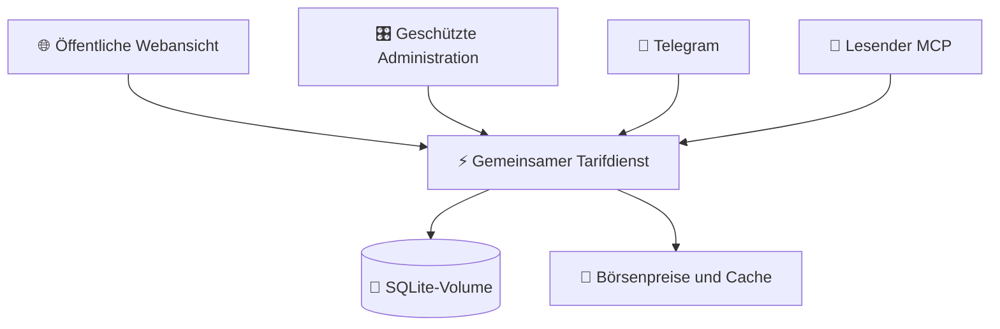

<p align="center"></p>

<h1 align="center">⚡ hAI.FlexPowerInfo · highfishAI</h1>
<p align="center">Dein Strompreis. Dein Tarif. Transparent aufgeschlüsselt.</p>
<p align="center"><a href="LICENSE"></a>   </p>

## 🌈 Eine Preisbasis. Drei Zugänge.

hAI.FlexPowerInfo verbindet Börsenpreise mit deinem Tarif: als öffentliche Web-Preisübersicht, als Telegram-Auskunft und als lesender MCP-Dienst für Agenten. Das Ziel bleibt eine nachvollziehbare Strompreis-Zentrale auf deiner eigenen Infrastruktur. Architektur und Funktionsbeschreibung sind keine Build- oder Verfügbarkeitsgarantie.

| Zugang | Aufgabe |
| --- | --- |
| 🌐 `/` | Öffentliche Preisübersicht ohne Anmeldung |
| 🎛️ `/admin` | Geschützte Anmeldung und Tarifverwaltung |
| 🤖 `/mcp` | Öffentliche lesende MCP-Tools; optional mit Token |
| 💬 Telegram | Auskunft nur für freigegebene Nutzer |

## 🎛️ Dein Tarif

Energieanteil, frei benannte ct/kWh-Bestandteile, Umsatzsteuer, Grundpreis, Servicegebühr und optionale Energie-Untergrenze bilden die Tarifverwaltung. Energiepreise können dynamisch, fest oder als manueller Monats-/Referenzwert hinterlegt werden. Alle Tarifeingaben netto; Grundpreis separat. Gebühren folgen der ausgewählten Vertragsbasis. Ausgangspunkt ist ein Immergrün-Tarif, ohne feste Anbieterbindung.

```text
⚡ Energie + 🧩 Tarifbestandteile + 🧮 Servicegebühr
= Netto-Arbeitspreis + Umsatzsteuer
= Geschätzter Brutto-Arbeitspreis in ct/kWh
```

## 💬 Telegram ohne doppelte IDs

Für private Chats reichen `TELEGRAM_BOT_TOKEN` und `TELEGRAM_USER_IDS`. Ohne Chat-Liste akzeptiert der Bot ausschließlich private Chats der freigegebenen Nutzer. `TELEGRAM_CHAT_IDS` ist optional für explizite Ziele, etwa Gruppen; die Absenderfreigabe bleibt zusätzlich erforderlich. Inline-Menü: Preis, Verlauf, Tarif und Status. Dedizierten Bot ohne aktiven Webhook verwenden.

## 🤖 Öffentlicher Preis-MCP

`MCP_PUBLIC=true` erlaubt anonyme lesende Abfragen. `get_current_price`, `get_price_schedule`, `get_tariff` und `get_status` liefern Preiswerte, Komponenten, Zeitbezug und Aktualität. Die öffentliche Tarifzusammenfassung enthält Modell, Umsatzsteuer, Bestandteile und Netto-Grundpreis, aber nicht Tarifname, vollständige Einstellungen, Zugangsdaten oder interne Fehlermeldungen. Damit sind Preise und diese Bestandteile bewusst öffentlich.

Optional `MCP_PUBLIC=false` und einen eigenen `MCP_TOKEN` mit mindestens 32 Zeichen setzen. Statische Bearer-Authentifizierung, keine OAuth-Discovery. Administration bleibt unabhängig davon geschützt. `PUBLIC_DASHBOARD=false` deaktiviert die öffentliche Web-Ansicht, nicht automatisch den öffentlichen MCP.

## 🐳 Ein Container. Eine gemeinsame Preisbasis.



Stack-Datei: `docker-compose.yml` · Host-Port: `8911` · Container-Port: `8080` · externes Netzwerk: `highfishNetwork`.

Eine optionale `PUBLIC_URL`, beispielsweise `https://strom.example.org`, vereinfacht Host- und Origin-Konfiguration. Ohne diese Angabe sind Hosts offen; vorhandene Origin-Header werden gegen die tatsächlich angesprochene Origin geprüft. Für Internetbetrieb PUBLIC_URL und HTTPS setzen. Öffentliche Datenzugriffe sind auf Anwendungsebene auf 60 Anfragen pro Minute und Client-IP begrenzt; Proxy-Limits ergänzen.

## ⏱️ Transparenz statt Scheinpräzision

Optionaler Abruf alle 15 Minuten; Quelle und Vertrag bestimmen die Preisauflösung. Keine erfundenen Viertelstunden, keine automatisch berechnete Monatsreferenz. Ungeprüfte Tarife und alte Daten bleiben gekennzeichnet. Preise sind Schätzungen, keine Abrechnungsnachweise. Das Zielbild umfasst weitere Automatisierung; Schwellenwertalarme und Servicegebühren auf den Grundpreis sind nicht Teil dieser Umsetzung.

## 🚀 Betrieb und Lizenz

[Installation und ENV](INSTALL.md) · [Docker-Konvention](DOCKER.md) · [Projektseite](https://jbkunama1.github.io/hAI.FlexPowerInfo/) · [MIT-Lizenz](LICENSE)

Ein Projekt von highfishAI. Keine offizielle Anwendung von Immergrün oder aWATTar.
