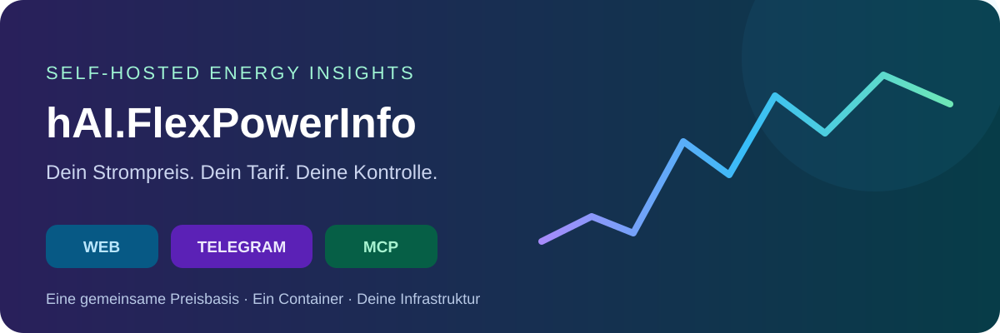

<p align="center"></p>
<h1 align="center">⚡ hAI.FlexPowerInfo · highfishAI</h1>
<p align="center">Dein Strompreis. Dein Tarif. Transparent aufgeschlüsselt.</p>
<p align="center"><a href="LICENSE"></a>   </p>

## 🌈 Eine Preisbasis. Drei Zugänge.

Börsenpreise mit deinem persönlichen Tarif verbinden und den Preis pro Kilowattstunde nachvollziehen: im Browser, per Telegram und per tokenpflichtigem MCP. Gemeinsamer Tarifdienst statt widersprüchlicher Berechnungen. Das Ziel ist eine flexible, selbst gehostete Strompreis-Zentrale; diese Beschreibung ist kein erfolgreicher Buildnachweis.

| Zugang | Zugriff |
| --- | --- |
| 🌐 `/` | Preis-Dashboard, optional öffentlich mit PUBLIC_DASHBOARD=true |
| 🎛️ `/admin` | Tarifverwaltung mit Admin-Login |
| 🤖 `/mcp` | Jede Anfrage ausschließlich mit Bearer-Token, lesend und schreibend |
| 💬 Telegram | Freigegebene Nutzer, separate Admin-IDs |

## 🔐 MCP erreichbar, niemals anonym

MCP_TOKEN ist für Initialisierung, Tool-Liste, Lesen und Schreiben erforderlich. Header: `Authorization: Bearer DEIN_TOKEN`. Leerer Token sperrt den Zugang. Der alte Schalter MCP_PUBLIC wird ignoriert und kann die Prüfung nicht abschalten. Statische Bearer-Authentifizierung, keine OAuth-Discovery. Extern nur mit HTTPS/VPN betreiben.

Tools: get_current_price, get_price_schedule, get_tariff, get_status und update_tariff. Der Token erlaubt alle diese Tools; es gibt keine getrennten Read-/Write-Rollen. update_tariff ersetzt den vollständigen Tarif nach Eingabeprüfung und setzt die Prüfbestätigung zurück. Vor einer Änderung den Tarif abrufen und mit dem Nutzer abstimmen. Keine Secret-Verwaltung oder beliebigen Serverbefehle.

Die öffentliche Webansicht ist unabhängig von MCP. Bei PUBLIC_DASHBOARD=true bleiben die dort sichtbaren Preise und Bestandteile anonym abrufbar. Für private Preisdaten zusätzlich PUBLIC_DASHBOARD=false setzen.

## 🎛️ Dein Tarif

Energieanteil, frei benannte ct/kWh-Bestandteile, Umsatzsteuer, Grundpreis, Servicegebühr und optionale Energie-Untergrenze. Dynamischer Energiepreis, fester Wert oder manueller Monats-/Referenzwert. Alle Eingaben netto, Grundpreis separat. Gebühren folgen der ausgewählten Vertragsbasis. Ausgangspunkt: ein Immergrün-Tarif, ohne feste Anbieterbindung.

```text
⚡ Energie + 🧩 Zuschläge + 🧮 Servicegebühr
= Netto-Arbeitspreis + Umsatzsteuer
= Geschätzter Brutto-Arbeitspreis in ct/kWh
```

## 💬 Telegram mit Admin-Menü

Für private Chats reichen TELEGRAM_BOT_TOKEN und TELEGRAM_USER_IDS. Schreibrechte zusätzlich über TELEGRAM_ADMIN_IDS, ausschließlich privat. Startnachricht, Inline-Menü, Preisgrafik und bestätigte Änderungen einzelner Tarifwerte. Details: [TELEGRAM.md](TELEGRAM.md).

## 🐳 Betrieb

Ein Container, SQLite-Volume, `docker-compose.yml`, Port 8911 → 8080, externes Netzwerk highfishNetwork. PUBLIC_URL vereinfacht Host-/Origin-Prüfung; für Internetbetrieb die eigene HTTPS-Origin setzen. Admin-Passwort mindestens 4 Zeichen; MCP-Token mindestens 32 Zeichen. Öffentliche/autorisiert ausgeführte Datenzugriffe sind begrenzt; Reverse-Proxy-Limits ergänzen.

## ⏱️ Nachvollziehbare Daten

Optionaler Abruf alle 15 Minuten. Quelle und Vertrag bestimmen die tatsächlichen Intervalle. Keine erfundenen Viertelstunden, Monatsreferenzen manuell. Veraltete Daten und ungeprüfte Tarife werden markiert. Kein Abrechnungsnachweis, keine Verbrauchsmessung, keine Servicegebühr auf den Grundpreis. Weitere Automatisierung bleibt Teil des Zielbilds.

[Installation](INSTALL.md) · [MCP](MCP.md) · [Docker](DOCKER.md) · [Projektseite](https://jbkunama1.github.io/hAI.FlexPowerInfo/) · [MIT](LICENSE)

Ein Projekt von highfishAI. Keine offizielle Anwendung von Immergrün oder aWATTar.
